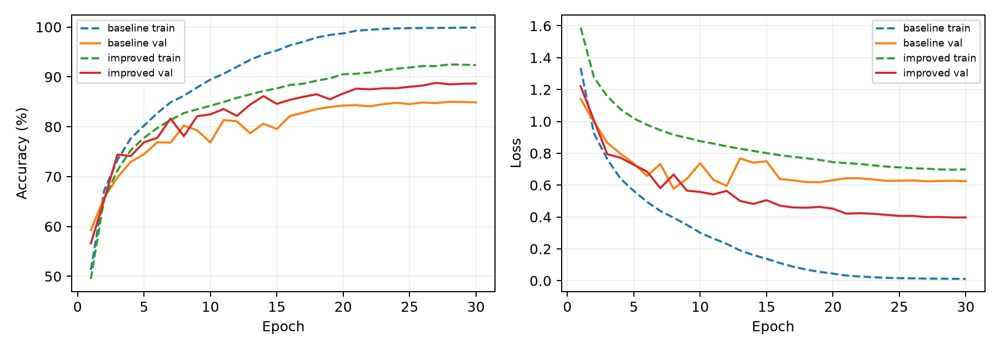
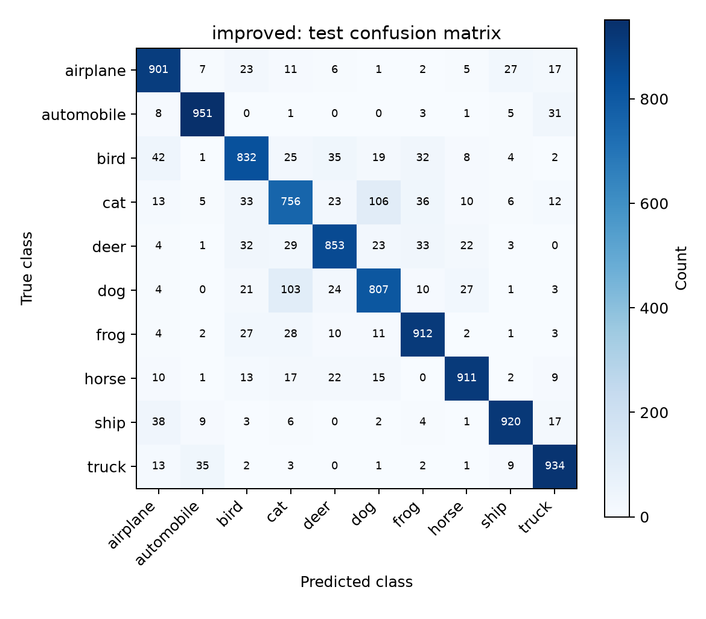
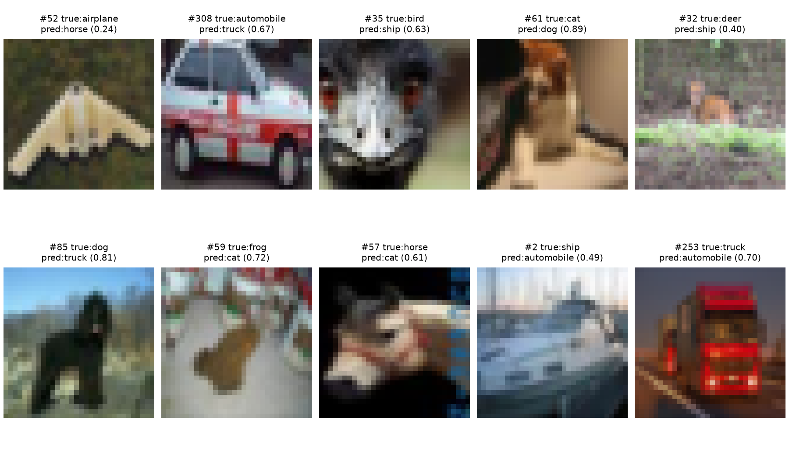
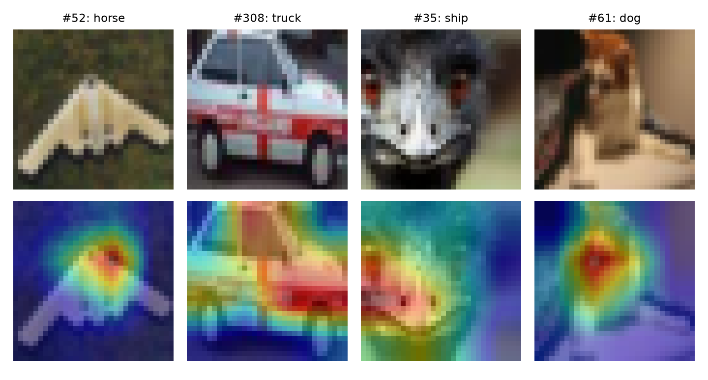

## 实验三 图像分类模型设计与实现

使用 CIFAR-10 完成从零训练、验证选择、测试评估与误差分析。按验证集选中的模型是 improved，测试总体准确率 87.77%。全部数字与图片来自本次实际运行。

## 一 数据划分与实验设置

官方训练集50000张按类别分层划分：每类4500张训练、500张验证，共45000/5000张；官方10000张测试集仅在训练与模型选择结束后评估。固定种子2026，划分索引随结果保存。图像32×32、RGB；像素除255后用均值和标准差0.5映射到[-1,1]，未用验证或测试数据估计归一化统计量。

数据来源：https://www.cs.toronto.edu/~kriz/cifar.html。归档按官方MD5 c58f30108f718f92721af3b95e74349a 核验，torchvision 再检查分批文件。

| 设置 | 配置 |
| --- | --- |
| 训练设备 | NVIDIA GeForce RTX 4070 Laptop GPU |
| PyTorch | 2.11.0+cu128 |
| 训练预算 | 每模型30轮，batch=256 |
| 优化器 | AdamW；初始lr=0.002；weight decay=0.0005 |
| 学习率 | 余弦退火至0.00002 |
| 模型选择 | 各自验证准确率最高的checkpoint，平局保留首次 |
| 随机性 | 固定随机种子；CUDA可能仍有非确定性误差 |

| 模型 | 参数量 | 最佳轮次 | 验证准确率 | 测试准确率 |
| --- | --- | --- | --- | --- |
| baseline | 288746 | 28 | 85.00% | 84.86% |
| improved | 304710 | 27 | 88.80% | 87.77% |

实际训练起始时间：2026-11-06T14:12:07.915804+08:00。GPU训练使用自动混合精度，验证与测试使用float32。baseline训练耗时47.2秒；improved训练耗时192.4秒。

模型架构与超参数先确定，再执行一次固定种子的完整实验；测试结果只用于报告最终性能，不能用于继续调整超参数。本实验没有使用预训练权重。

## 二 模型原理与训练过程

基础CNN有三个卷积块，通道数依次32、64、128，每块为两次3×3卷积、BatchNorm、ReLU和2×2最大池化，空间分辨率从32降至16、8、4。全局平均池化后接Dropout(0.2)与128→10线性分类器，输出未归一化logits，交叉熵内部完成分类概率处理。

改进模型在每块加入1×1投影残差与SE通道注意力。SE利用全局平均池化汇总各通道，再通过两层1×1映射和Sigmoid生成通道权重。训练时增加反射填充4像素后的随机裁剪、随机水平翻转，并使用0.1标签平滑；验证和测试不增强。

图一 两个模型的训练及验证曲线。训练准确率在训练模式下统计，改进模型使用增强图像；验证在eval模式下使用原始图像。因此训练/验证曲线的差异还受到Dropout、BatchNorm模式和输入难度影响。

最后一轮：baseline训练准确率99.88%，验证准确率84.88%；improved训练准确率92.36%，验证准确率88.66%。训练准确率高而验证没有同步提高时，提示对训练数据的拟合超出了泛化收益；最终仍使用最佳验证checkpoint。

改进模型的训练loss包含标签平滑，验证loss使用标准交叉熵，数值不能直接作等价比较。余弦调度在后期减小更新幅度；保存最佳验证轮次而非直接采用最终轮次，可降低后期过拟合对交付模型的影响。

两模型同时改变了结构、增强和损失函数，是组合改进对照，不是单因素消融。若要判断每一项的独立贡献，需要固定其余条件，分别移除SE、残差、增强与平滑，并进行多个随机种子重复实验。

## 三 测试集混淆矩阵与分类表现

| 类别 | baseline | improved |
| --- | --- | --- |
| airplane | 87.80% | 90.10% |
| automobile | 93.50% | 95.10% |
| bird | 76.90% | 83.20% |
| cat | 69.70% | 75.60% |
| deer | 83.80% | 85.30% |
| dog | 77.80% | 80.70% |
| frog | 87.30% | 91.20% |
| horse | 87.20% | 91.10% |
| ship | 92.20% | 92.00% |
| truck | 92.40% | 93.40% |

图二 行为真实类别，列为预测类别。每类准确率定义为该类正确数/该类测试总数，即召回率；本测试集每类1000张，因此宏平均召回率等于总体准确率。矩阵总数为10000，对角和/10000与报告总体准确率一致。

## 四 误分类样本与错误分析

图三 对每个真实类别，按测试集索引选取第一个误分类，展示原图、真实标签、预测标签及预测概率。选择规则固定，避免只挑选容易解释或特别极端的样例。

| 真实类别 | 误判类别 | 数量 |
| --- | --- | --- |
| cat | dog | 106 |
| dog | cat | 103 |
| bird | airplane | 42 |
| ship | airplane | 38 |
| cat | frog | 36 |

猫被判为狗106次，狗被判为猫103次；猫的每类准确率仅75.60%，是主要薄弱类别。样本#61的猫以0.89概率被判为狗，说明高置信度也会出错。#308汽车和#253卡车都呈正面视角，车窗、车头轮廓相似而车身信息有限，可能增加汽车与卡车的混淆。这些是结合图片的解释线索，不是因果证明。

预测概率不是可靠性保证：错误预测也可能具有较高置信度。标签平滑有助于降低过强的训练目标，但本实验没有单独验证概率校准改善；后续应在独立验证数据上测量可靠性图或ECE，而不是仅凭几个错误样例判断。

进一步改进可优先分析高频混淆类别，采用更强的空间特征或更丰富的数据增强；任何改进都应先在验证集上比较，并保持测试集隔离。

## 五 可解释性 验证与总结

图四 前四个误分类样本的Grad-CAM：上行为原图，下行为最后一个卷积块的热图叠加。以模型预测类别的logit求梯度，对空间梯度求均值作为通道权重，ReLU后上采样到32×32。它反映局部梯度敏感区域，不等于像素级因果解释或目标分割。

红色表示该图内较高响应，蓝色较低。#52的响应集中于飞机中部，#308在车窗和车头都有响应，#61集中于图像中部局部。即使热点覆盖目标区域，仍可能预测错误，因此“关注到物体”不等于已经正确识别类别。

最后特征图仅4×4，上采样会使热点显得平滑；热图逐图归一化，不能比较不同图片的绝对证据强度。对背景或对象局部的响应只能作为进一步检查的线索，不足以证明模型学到了完整语义。

验证包含：训练/验证索引不相交且数量正确；两模型输出维度为batch×10；模型检查点可重载；全部测试预测与标签数量一致；混淆矩阵行和为1000、总和10000；由矩阵重算的准确率与汇总一致。训练日志逐轮落盘，最优权重独立保存。

复现顺序：python train.py；python make_figures.py；python build_report.py。训练需要PyTorch及torchvision，生成图表需要matplotlib，生成报告需要reportlab。检查点、划分、逐图预测、每类准确率和训练日志随作业保存；原始数据另行下载。

本次测试中改进模型相对基础模型的准确率变化为+2.91个百分点。结论仅针对当前固定种子与训练预算；没有多次重复，不能给出统计显著性结论。实验完成了CNN设计、规范的数据划分、训练与评估、错误分析和梯度可视化，并明确了组合对照及解释图的适用边界。
